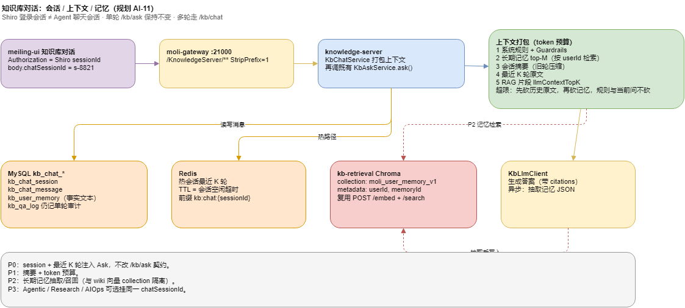

# 知识库对话：会话、上下文与长短期记忆（AI-11 方案）

> 状态：**P0 已落地 · 2026-09-10**（P1 摘要/预算、P2 长期记忆未开工）  
> 施工契约（字段/不变量/验收）：[`contracts/AI-11-contract.md`](contracts/AI-11-contract.md)  
> 范围：`moli-knowledge-server` + meiling-ui 智能问答；**不**引入 AgentScope / Spring AI / LangChain4j  
> 栈：Java 8、Spring Boot 2、既有 `KbAskService` / `KbLlmClient` / `kb-retrieval`

> 源文件：[moli-kb-agent-memory.drawio](../diagrams/moli-kb-agent-memory.drawio)（含架构页 + P0 时序页；PNG 未导出时用 diagrams.net 打开）

本文件讲**为什么和怎么分层**；落地以契约为准。G8「无多轮/无记忆」是开工前缺口；AI-1～10 已收官，本波只补这一条。

---

## 1. 问题

今日 `/kb/ask` 是**单轮**：请求里只有 `question`。`kb_qa_log` 是审计，不是会话。Shiro `sessionId` 只证明登录身份。ChatBI `/bi/chat/ask` 查业务库 SQL，与知识库问答不是同一条链路。

| 能力 | 缺什么 | 本波 |
|------|--------|------|
| 会话管理 | 没有 `chatSessionId` | **P0** |
| 短期记忆 | 最近 N 轮不进 prompt | **P0** |
| 上下文预算 | 无 token 裁剪、无滚摘要 | P1 |
| 长期记忆 | 无跨会话用户事实 | P2 |

**非目标**：改登录态；把 wiki 当用户记忆；金融级记忆审计；Java 21 / Boot 3；改 `/kb/ask` HTTP 契约。

---

## 2. 分层（与登录会话拆开）

Shiro sessionId → 你是谁（已有）。  
`kb_chat_session.id` → 这是哪一次聊天。  
`kb_chat_message` → 这一次里说过什么（短时）。  
`kb_user_memory` → 跨聊天还要记住的事实（长时，P2）。  
上下文打包器 → 这一次 LLM 调用塞哪些 token。

P0 只实现前三层里的 session + message + 最近 K 轮打包。

---

## 3. 数据

增量编号 **`docs/sql/43_kb_chat_session.sql`**（不可用 42，已占用）。列定义与索引见契约 §2。P0 两张表；P2 再加 `kb_user_memory`。向量记忆必须用独立 Chroma collection，禁止写入 wiki 的 `moli_kb_chunks_bgem3_v1`。

---

## 4. API 与接线

均挂 `/kb/chat/**`，权限复用 **`kb:ask:list`**。核心是 `POST /kb/chat/sessions/{id}/messages`：内部 `ask(req, ChatPack)`，公开 `ask(req)` 零行为变化。

检索用「上一轮用户问 + 本轮问」；生成才带最近 K=6 轮原文。Chat 路径跳过 AI-8 语义缓存（C-INV-4）。

字段表、错误码、验收见契约 §3～§6。

---

## 5. 上下文打包

优先级从高到低（P1 才按 token 砍；P0 只按轮数砍最旧）：

1. 系统规则（Ask 现有 +「摘录只用于指代，事实以检索片段为准」）  
2. 本轮用户问题  
3. RAG 片段（`llmContextTopK`）  
4. P2 长期记忆 top-M  
5. `session.summary`  
6. 最近 K 轮原文（默认 6）

幻觉约束不变：数字/结论须 citations。Guardrails 看**本轮原文**。

---

## 6. 长期记忆（P2，不开工）

关会话或每 N 轮抽出 ≤5 条「对用户以后有用」的事实；PII 走既有脱敏；读出时 `filter.userId` 必须等于当前用户；与 RAG 分栏进 prompt。

---

## 7. 分期

| 阶段 | 做 | 验收摘要 |
|------|----|----------|
| **P0** | 表 + Chat API + K 轮注入；问答页加会话栏 | 两轮指代可接上；Ask 单测 / ngram 评测零回归 |
| **P1** | token 预算、滚摘要 | 20 轮后 prompt 仍低于预算 |
| **P2** | 抽取 + 独立 collection | 新 session 能召回「昨天那个网关」；隔离他人 |
| **P3** | Agentic/Research 可选挂 session | 不在第一刀 |

前端：不新增菜单，改 902 智能问答。旧「单次 `/kb/ask`」保留给评测。

---

## 8. 风险

| 风险 | 处理 |
|------|------|
| 历史把错误结论带进下一轮 | Prompt 写明事实以 citations 为准 |
| 记忆泄漏 | 所有查询强制 `user_id`；P2 Chroma 同等 filter |
| 语义缓存串会话 | P0 Chat 不走 lookup/put |
| sidecar 挂了 | P2 降级跳过长时；P0 不依赖 sidecar 记忆 |

---

## 9. 默认已拍板（无异议即按此开工）

1. 权限 `kb:ask:list`，不新造 `kb:chat:*`  
2. 不新增侧栏菜单  
3. P0 无 Redis、无 `kb_user_memory`  
4. 对话默认 `useLlm=true`  
5. SQL 文件号 **43**

未确认前不改 `/kb/ask`、不改 golden 门禁。施工入口：契约 §8。
